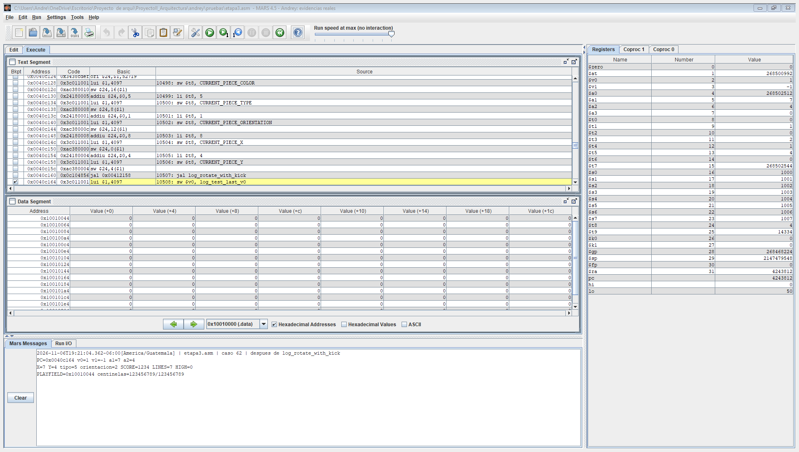
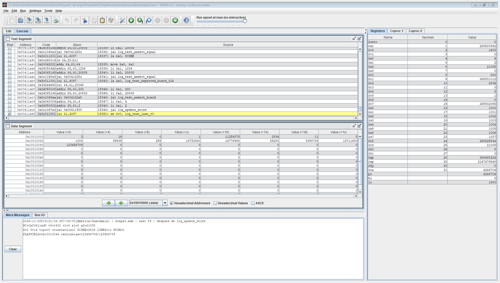

# Aporte de Andrey al informe

**Proyecto 2 — EIF205 Arquitectura de Computadoras**

**Universidad Nacional de Costa Rica**

**Responsable del aporte: Andrey**

**Estado al 2026-11-06: aporte individual documentado y verificado de forma aislada. Validación conjunta pendiente de integración.**

## Alcance

El aporte comprende la lógica del tablero en `logica.asm`, la organización de las formas en `piezas.asm`, las pruebas de colisiones y límites y la coordinación de la bitácora de errores. El proyecto parte de una versión existente de Tetris en ensamblador MIPS para MARS, cuyo uso fue autorizado por el profesor según el contexto del equipo.

La implementación conserva las formas originales de las siete piezas. Se adaptaron los recorridos del tablero a las constantes `ANCHO` y `ALTO`, se corrigió la conservación de registros, se incorporaron identificadores de piezas, se separó el cálculo del puntaje por jugada y se añadieron caída instantánea y rotación con corrimiento sencillo.

El núcleo, los datos compartidos y los niveles corresponden a Keilor. Los gráficos, las macros y la fuente corresponden a Jorge. Las modificaciones necesarias en esos módulos se documentaron como contratos pendientes de integración.

## Representación y límites

El tablero lógico contiene 10 × 20 celdas. Cada celda ocupa una palabra de cuatro bytes, para un total lógico de 800 bytes. La posición `(x,y)` se traduce a `PLAYFIELD + 4 × (y × ANCHO + x)`.

Las colisiones se comprueban sobre los cuatro bloques de la forma. Se validan las coordenadas absolutas antes de leer el tablero; una celda distinta de cero representa ocupación. Un origen negativo no implica necesariamente una colisión: lo que determina la validez son las coordenadas finales de cada bloque.

El tipo activo usa valores de 0 a 6. Al fijar una pieza se almacena el tipo más uno, conservando el valor 0 para celdas vacías. Esto permite que los gráficos determinen el color de los bloques fijados. Los desplazamientos copian los valores completos para preservar la identificación.

## Procedimientos desarrollados y adaptados

| Procedimiento | Descripción del aporte |
|---|---|
| `initialize_playfield` | Limpia la cantidad de palabras calculada con ambas dimensiones. |
| `check_collision` | Valida paredes, límite superior, piso y ocupación; reconoce todos los IDs no nulos. |
| `freeze_piece` | Valida antes de escribir y fija los cuatro bloques con ID de 1 a 7. |
| `shift_rows_down` | Desplaza filas, conserva IDs y maneja la fila 0 sin leer una fila negativa. |
| `clear_top_row` | Limpia una fila de ancho configurable sin alterar registros preservados. |
| `check_and_clear_lines` | Cuenta todas las filas de una jugada, vuelve a revisar una fila después de desplazar y retorna la cantidad. |
| `log_update_score` | Otorga 100/300/500/800 por 1/2/3/4 líneas, multiplicado por el nivel recibido. |
| `update_high_score` | Compara puntaje y récord conservando los registros del llamador. |
| `log_hard_drop` | Revisa cada fila intermedia, conserva la última posición válida y fija inmediatamente. |
| `log_rotate_with_kick` | Prueba la orientación siguiente en la posición original, una celda a la izquierda y una a la derecha. |

El conteo de líneas se mantiene en un registro preservado durante las llamadas auxiliares. El acumulado de líneas se actualiza una sola vez. El puntaje se calcula por el conjunto de líneas, no mediante premios individuales que perderían la diferencia entre una y varias líneas.

La caída instantánea no elimina líneas ni genera otra pieza. Esa separación permite que el núcleo finalice la jugada una vez. El wall kick solo escribe el nuevo estado después de aceptar un intento; si todos fallan, el estado original permanece intacto.

## Pruebas de colisiones y límites

Se ejecutaron tres suites aisladas en MARS 4.5, con delayed branching desactivado:

| Suite | Escenarios | Comprobaciones |
|---|---:|---:|
| Tablero, límites y registros | 42 | 4580 |
| Identificadores, conteo y puntaje | 104 | 12311 |
| Caída instantánea y wall kick | 89 | 21020 |
| **Total de lógica** | **235** | **37911** |

Las tres suites pasaron. Se probaron ambas paredes, piso, posiciones negativas, celdas ocupadas con los siete IDs, apariciones bloqueadas, fijación rechazada sin escrituras parciales, eliminación de una a cuatro líneas, limpieza superior y conservación de registros y pila. También se recorrieron las siete piezas en sus cuatro orientaciones y los puntajes de 0–4 líneas en los niveles 1–10.

Los datos de prueba incluyen un tablero de exactamente 200 palabras con centinelas adyacentes. El 2026-11-06 se volvieron a ejecutar las tres suites y se exportaron 29 vistas de los componentes reales de MARS mediante `JFrame.printAll`. Son exportaciones de la ventana después de ejecutar el código, no capturas del escritorio ni dibujos de valores esperados. Cada vista de lógica incluye un registro de sus retornos, registros y 200 celdas. El [índice de evidencias](evidencias/CAPTURAS_PENDIENTES.md) permite consultar las imágenes, los registros y las consolas finales.

Ejemplos de las evidencias obtenidas:

## Errores corregidos y prueba cruzada

| Error | Impacto | Corrección |
|---|---|---|
| Uso de `$s0` sin preservarlo al limpiar la fila superior | Alteración del recorrido del llamador | Puntero temporal en `$t2`. |
| Uso de `$s0/$s1` sin preservarlos al actualizar el récord | Pérdida de valores del llamador | Comparación con registros temporales. |
| Dimensiones heredadas y validación vertical incompleta | Riesgo de acceder a una celda lógica inválida | Dimensiones simbólicas y comprobaciones previas a la dirección. |
| Ocupación reconocida solo con valor 1 | Omisión de otros IDs | Comparación contra cero. |
| Fijación sin validación completa propia | Posibles escrituras inválidas o parciales | Validación previa de posición y tipo. |
| Puntaje por cada línea aislada | Incumplimiento de premios por jugada | Conteo acumulado y cálculo separado con nivel recibido. |

La bitácora contiene la fecha de registro, la evidencia y el commit de cada corrección. Las ocho correcciones de lógica están incluidas en el commit real `f74780c`, del 2026-11-01. Los cambios de otros módulos continúan pendientes y no se les atribuye ese commit.

Como primera prueba cruzada se ejecutó `draw_scene` de la base antigua de Jorge sin modificarlo. Se detectó que no conservaba `$s0–$s2` y que dibujaba un marcador colocado en el índice 200, fuera del tablero lógico nuevo. Ambos resultados quedaron registrados antes de consultar los avances remotos del equipo.

Estos dos hallazgos corresponden a la base local antigua. Al consultar el main remoto `d4c1810` el 2026-11-06, ambos comportamientos ya estaban adaptados. Se armó un candidato temporal con los módulos actuales del equipo y los archivos de lógica/piezas de Andrey, sin editar sus módulos. El main candidato ensambló y la nueva prueba cruzada obtuvo 36 de 43 comparaciones aprobadas. Las siete fallidas muestran que los IDs todavía se dibujan con el mismo color; el detalle está en [cruce_referencia_2026-11-06.txt](evidencias/cruce_referencia_2026-11-06.txt).

Las 27 comparaciones del contrato lógica/núcleo pasaron: caída y fijación sin puntaje duplicado, cuenta de cuatro líneas, premio con nivel explícito, acumulado sin recuento y actualización del nivel. También pasaron las comprobaciones del nivel en 0, 4, 5, 6, 45, 49 y 50 líneas y la transición a victoria en 50. Son llamadas directas al `update_speed` real de Keilor; no prueban que el teclado o el aterrizaje del núcleo ya invoquen los procedimientos nuevos. Se añadieron dos vistas de esta ejecución: hay **31 imágenes** en total.

## Conclusión de mi trabajo

La lógica quedó organizada alrededor de un tablero como fuente de verdad y de procedimientos con argumentos, retornos y registros documentados. Las validaciones antes de acceder a memoria, la fijación completa y la conservación de los identificadores permiten comprobar el comportamiento sin depender del dibujo.

Mi aporte deja implementadas las funciones obligatorias de lógica y conserva las formas de las piezas, con 235 escenarios aprobados, evidencia visual del simulador y una prueba cruzada registrada. La [guía de defensa](DEFENSA.md) explica las decisiones y las instrucciones utilizadas.

El cierre del proyecto requiere conectar las llamadas desde el núcleo, acordar la regla de nivel usada para puntuar, seleccionar los colores de IDs en gráficos y repetir las pruebas en una partida completa. El main candidato actualizado ensambla; el error por dimensiones se mantiene solo en la base antigua conservada en la rama local. Las pruebas con módulos actuales permiten cerrar los hallazgos anteriores en esa referencia y concretar lo que aún necesita coordinación. No se presenta la partida conjunta como aprobada.
